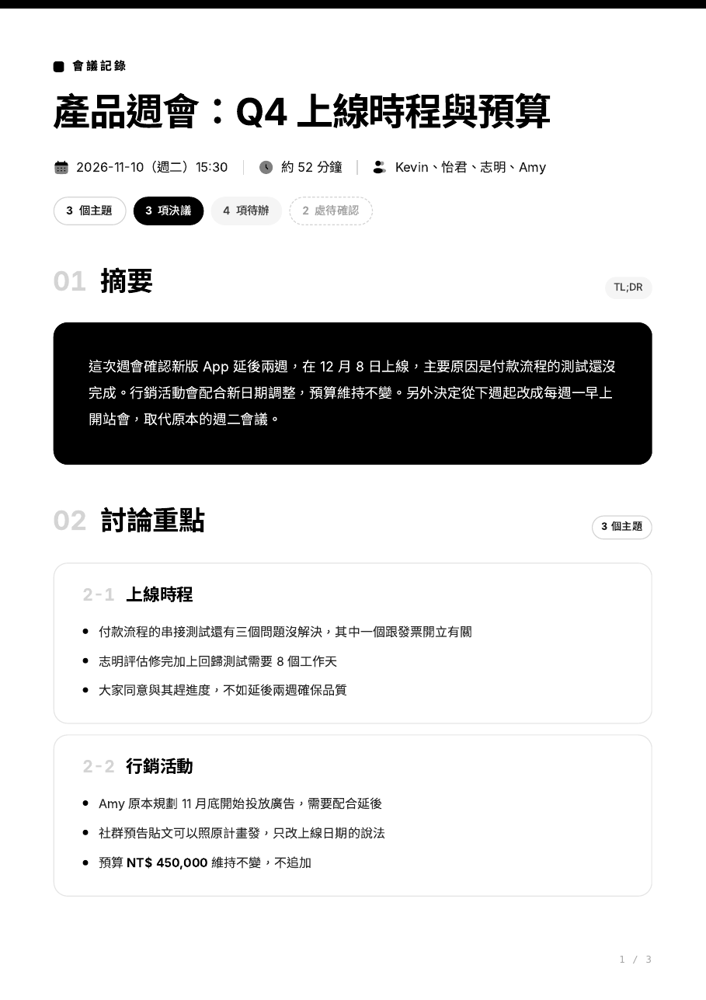

# meeting-minutes

在 Mac 上錄下實體會議，自動轉成逐字稿，再整理成固定格式的會議記錄和黑白極簡風格的 PDF。

```
meeting 週會  →  按 q 結束  →  audio.wav → transcript.txt → minutes.md → minutes.pdf
```



- **錄音**：ffmpeg，用名稱找麥克風，iPhone 連上或斷開也不會錄錯裝置
- **逐字稿**：whisper.cpp，在本機跑，錄音不會上傳；自動轉成台灣繁體
- **整理**：Claude Code 依固定格式寫出摘要、討論重點、決議事項、待辦事項、待確認
- **PDF**：Tailwind 版型，用 Chrome 列印，文字可以選取和搜尋，不需要網路

範例：[example-minutes.md](docs/example-minutes.md) → [example-minutes.pdf](docs/example-minutes.pdf)

## 安裝

需要 macOS 和 [Homebrew](https://brew.sh)。打開 Terminal 貼上：

```bash
curl -fsSL https://raw.githubusercontent.com/heykaiyi/meeting-minutes/main/install.sh | bash
```

安裝程式會一步一步帶你完成：

1. 安裝 ffmpeg、whisper.cpp、opencc（已經裝過的會跳過）
2. 下載 Whisper 模型（推薦 large-v3-turbo，約 1.6 GB；之前下載過的會直接沿用）
3. 列出麥克風讓你選，並標出 Microsoft Teams Audio 這類錄不到現場聲音的虛擬裝置
4. 選擇會議檔案存放位置（預設 `~/Meetings`）
5. 把 skill 連結到 `~/.claude/skills/meeting-minutes`
6. 在 `~/.zshrc` 加入快捷指令
7. 錄 3 秒測試麥克風和權限

裝完重新開一個 Terminal 視窗就能用。

也可以先 clone 再安裝：

```bash
git clone https://github.com/heykaiyi/meeting-minutes.git ~/.meeting-minutes
bash ~/.meeting-minutes/install.sh
```

## 使用

| 指令 | 做什麼 |
|---|---|
| `meeting 週會` | 開始錄音，按 `q` 結束，接著自動產生逐字稿、md、pdf |
| `stt 錄音.m4a` | 只轉逐字稿（wav / m4a / mp3 都可以） |
| `minutes` | 把最新一場會議整理成 md + pdf；也可以指定資料夾或 txt |
| `md2pdf minutes.md` | 只把 md 轉成 pdf；加 `--html` 會留下網頁版 |
| `meetings` | 打開會議資料夾 |
| `meeting-help` | 列出所有指令 |

每場會議一個資料夾：

```
~/Meetings/2026-11-10_1530_週會/
├── audio.wav          錄音
├── transcript.txt     逐字稿
├── transcript.srt     有時間軸的逐字稿
├── minutes.md         會議記錄
└── minutes.pdf        PDF
```

### 臨時改設定

只影響這一次，不會改到設定檔：

```bash
MIC=iPhone meeting 週會          # 用 iPhone 收音
AUTO_MINUTES=0 meeting 週會      # 錄完只轉逐字稿
WHISPER_LANG=en stt meeting.wav  # 英文會議
```

### 重新設定

```bash
meeting-setup          # 完整重跑
meeting-setup mic      # 重新選麥克風
meeting-setup model    # 換模型
meeting-setup folder   # 改會議資料夾
meeting-setup test     # 錄 3 秒測試
meeting-setup check    # 查看目前狀態
meeting-update         # 從 GitHub 更新
```

設定存在 `~/.config/meeting-minutes/config`，也可以直接編輯。

## 沒有 Claude Code 也能用

錄音和逐字稿完全在本機跑，不需要 Claude Code。沒有 `claude` 指令時，`meeting` 會停在逐字稿這一步；把 `transcript.txt` 拖進 Claude，說「用 meeting-minutes 整理」就可以。

## 移除

```bash
bash ~/.meeting-minutes/uninstall.sh
```

會移除快捷指令和 skill，並詢問是否刪除設定檔和模型。會議檔案和 brew 套件不會動到。

## 專案結構

```
install.sh                安裝 / 重新設定
uninstall.sh              移除
shell/meeting-minutes.sh  快捷指令（zsh / bash）
skill/meeting-minutes/    Claude skill
├── SKILL.md              整理規則
├── assets/template.md    會議記錄的固定格式
├── assets/tailwind.css   預先編譯的 Tailwind 版型
├── assets/print.css      A4 頁面、首頁色條、頁碼
├── assets/icons.json     Solar Bold Duotone 圖示
└── scripts/              record / transcribe / minutes / md2pdf
```

## 授權

圖示來自 480 Design 的 Solar Icon Set（CC BY 4.0），經 [SVG Repo](https://www.svgrepo.com/collection/solar-bold-duotone-icons/) 取得。
